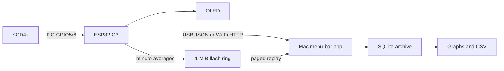

# Architecture and project handoff

## Components

- `firmware/src/main.cpp`: Arduino ESP32-C3 application, shared I2C bus,
  SSD1306 72×40 OLED, direct SCD4x protocol with CRC8, USB JSON commands,
  local HTTP API, NVS provisioning, optional Wi-Fi/mDNS/NTP.
- `firmware/include/Journal.h`: storage abstraction and portable NOR-flash ring.
- `macos/CO2Monitor.swift`: native AppKit menu-bar app, SQLite history, USB and
  HTTP transport, CO₂ plots over 24 hours / 7 days, temperature plots over
  7 days / 24 days, CSV export and connection settings.
- `tools/board.py`: local USB provisioning, diagnostics, CSV export.
- `enclosure/v0.9`: final measured geometry, print files and digital checks.

## Data flow

The sensor produces readings about every five seconds. Each minute, the firmware
appends the mean of available successful readings. Failed reads are not filled
with fabricated values. Live readings are stale after 20 seconds. The Mac polls
about every five seconds and imports up to eight 64-record pages per refresh.

## Storage contract

The 4 MiB partition layout is in `firmware/partitions.csv`: NVS at 0x9000,
PHY at 0xe000, one application at 0x10000 (size 0x2f0000), journal at 0x300000
(size 0x100000). There is no OTA partition or SD card.

Journal records are packed little-endian 32-byte values: magic uint32,
sequence uint64, unix_s / boot / uptime_s uint32, CO2 uint16, temperature in
hundredths int16, RH in hundredths uint16, CRC16 uint16. CRC16-CCITT starts
at 0xffff and covers the first 30 bytes. The sensor wire CRC8 is a different
checksum: polynomial 0x31, initial value 0xff.

Records occupy 4096-byte erase sectors, 128 records per sector. There are 32768
slots, roughly 22.8 days at one record per minute. Erasure at wrap removes the
oldest sector, so usable occupancy varies by up to 127 records. Startup scans
valid records. Torn records are ignored; appending skips programmed slots
rather than writing over torn bytes. The current unfinished minute is lost
on power failure. Simulated partial writes do not establish hardware endurance
or protection against every possible brownout/erase failure.

The Mac archive keys records by `(device_id, sequence)`. `INSERT OR IGNORE`
makes repeated imports idempotent. The app retains gaps when a device buffer
has overwritten records not previously downloaded. Resetting sequence numbers
without migrating the Mac archive is unsupported and reported as an error.

## Clock semantics

`unix_s=0` means unknown absolute time. `boot` plus `uptime_s` preserves relative
time. A USB app connection can set device time; Wi-Fi can synchronize NTP.
The Mac records a per-boot epoch anchor from device time or its local clock,
and backfills records from that same boot. Historical boots never observed or
synchronized cannot be dated honestly. Their CSV date remains empty. An RTC or
reachable time server is required for guaranteed dates after arbitrary power loss.

## Connectivity and credentials

The device is a 2.4 GHz Wi-Fi station; no provisioning access point is created.
Hostname is derived from the chip identity. USB configuration stores SSID,
password and a random API token in NVS. The Mac stores hostname and token under
`~/Library/Application Support/CO2Monitor/config.json`, mode 0600. Passwords
are not stored in the checkout. NVS is not configured as encrypted storage.

HTTP is local plaintext with a Bearer token, not TLS. Do not expose it through
port forwarding. The Mac prefers HTTP when configured, then falls back to USB.
USB auto-selection requires exactly one `/dev/cu.usbmodem*` port in the native
app; the Python helper selects one Espressif VID 0x303a port or accepts `--port`.
Do not run two USB clients concurrently. Replies are type-filtered; history
replies are additionally checked against the requested cursor. Requests retry
after 1.5 seconds to tolerate the first CDC handshake after reset.

## Known boundaries

Initial supported app build: Apple Silicon, macOS 13+, local ad-hoc signature;
only the user's current Mac was tested. No autostart installer, notarization,
OTA, remote server, SD card, RTC or CO₂ alert colors are implemented. The app's
Wi-Fi setup menu launches a checkout-local command, so a standalone copied app
cannot provision Wi-Fi without the project environment. One active sensor is
the intended UI workflow, though SQLite keys include device identity.

Sensor temperature is influenced by the board and enclosure. No user-specific
temperature offset, reference-gas calibration or sealed-enclosure accuracy
validation has been done. CO₂ is not oxygen or carbon monoxide.

## Temperature charts (app 0.2.0)

`Metric` selects a fixed SQLite column (`co2` or `t`), title, unit, and axis
formatting. Temperature queries use the existing records and filter by device
and time window, including an upper cutoff to omit future-dated samples. The
axis preserves negative temperatures and has a nonzero span for constant values.
The chart window is reused, and refresh preserves its selected metric and period.
Gaps longer than three minutes are not bridged. No database migration, firmware
update or synthetic backfill is needed. A 24-day view uses the Mac archive; the
device's roughly 22.8-day ring alone cannot retain all 24 days.
