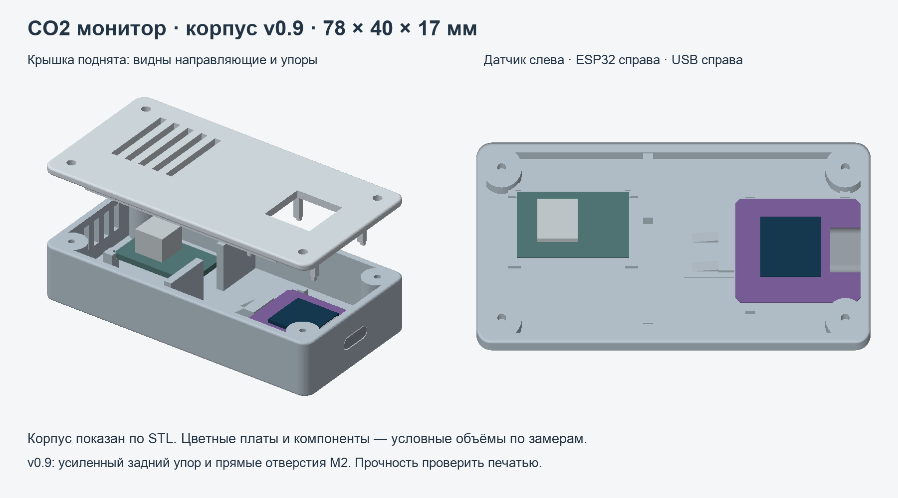

# CO₂ Monitor — ESP32-C3 + SCD4x

[English](../../README.md) · Команды выполняются из корня репозитория.

Показания CO₂, температуры и влажности на OLED и в строке меню Mac.
Плата сохраняет историю во внутренней flash, даже когда Mac спит.

## Что находится в репозитории

- `firmware/` — прошивка ESP32-C3.
- `macos/` — приложение для строки меню Mac.
- `enclosure/v0.9/` — STL, SCAD, генераторы, образцы и превью корпуса.
- [Аппаратная часть](HARDWARE.md), [архитектура](../ARCHITECTURE.md),
  [протокол](../PROTOCOL.md), [результаты проверок](VALIDATION.md).
- [Инструкции для AI](../../AGENTS.md).



## Подготовка после клонирования

Нужны macOS на Apple Silicon, Python 3.10+ и инструменты Xcode Command Line Tools
(`swiftc`, `clang++`, `codesign`). Готовые приложения, локальные ключи и данные
не включены в Git. Из корня клона:

```bash
python3 tools/setup.py
.tooling/venv/bin/python tools/build_macos.py
.tooling/venv/bin/python tools/check.py
```

Подготовка загружает PlatformIO и зависимости Python. Для сборки прошивки
PlatformIO дополнительно скачает платформу и библиотеки; для обычного запуска
уже прошитого устройства повторно прошивать его не нужно.

## Подключение

| Контакт датчика | Контакт ESP32-C3 |
|---|---|
| GND | GND |
| VDD | 3V3 |
| SDA | GPIO5 |
| SCL | GPIO6 |

OLED на этой версии платы также использует GPIO5/6. Адрес датчика —
0x62, OLED — 0x3C. Расположение контактов определять по маркировке платы,
а не по ориентации фотографии. Питание контроллера — через USB-C от Mac
или power bank; это не питание датчика напрямую от USB 5 В.

## Запуск на Mac

1. Подключить плату кабелем USB с передачей данных.
2. Если после прошивки сохранилась заводская надпись, нажать и отпустить RST.
3. Открыть `Открыть монитор.command` в этой папке. В строке меню появится CO₂.
4. Первое измерение ожидается примерно через 5 секунд, первая запись истории —
   через минуту. Если плата недоступна или показания устарели, приложение показывает «—».
5. В меню доступны графики CO₂ за сутки / неделю, температуры за **24 часа / 7 дней**,
   экспорт CSV и папка истории. Температура берётся из существующего архива,
   показывается в °C; недостающие участки истории остаются пустыми.

Приложение собрано для Apple Silicon, macOS 13+. Проверка на других версиях
macOS отдельно не проводилась. Это локальная сборка с ad-hoc подписью.
Не запускайте одновременно приложение и USB-диагностику: они используют один порт.

## Работа от power bank

При первом подключении к Mac открыть `Настроить Wi-Fi.command`.
Ввести имя сети 2,4 ГГц и пароль в локальном окне Terminal; пароль вводится скрыто.
После настройки перезапустить CO2 Monitor. Настройка Wi-Fi требует Python-окружение
`.tooling`, созданное в текущей папке проекта; перенос одного приложения его не переносит.

После этого можно питать прибор от power bank: связь с Mac идёт через домашний
Wi-Fi. Mac и датчик должны находиться в доступной друг для друга сети.
Если Mac спит или его нет дома, прибор продолжает вести журнал. При следующем
подключении приложение догружает сохранённые записи без дубликатов.
Проверить конкретный power bank: некоторые отключают выход при малой нагрузке.

## История и время

- Измерения датчика — примерно раз в 5 секунд.
- Запись в flash — среднее успешных измерений за минуту.
- Журнал 1 МиБ, до 32 768 записей: примерно 22 дня 18 часов. Это кольцевой
  буфер: затем старые записи постепенно заменяются новыми, секторами по 128 записей.
- Mac сохраняет выгруженные данные в SQLite без ограничения сроком буфера.
- Путь: `~/Library/Application Support/CO2Monitor/history.sqlite`.
- Последняя незавершённая минута при отключении питания не сохраняется.
  Записи имеют CRC; незавершённая запись flash после сбоя пропускается.
- Часы синхронизируются через интернет по Wi-Fi или при подключении приложения
  по USB. До синхронизации сохраняются номер запуска и время с начала запуска.
  Mac восстанавливает время таких записей, если видел этот же запуск.
- Если питание отключили до любой синхронизации и Mac не видел тот запуск,
  его абсолютное время восстановить нельзя. Измерения остаются в архиве и CSV
  с пустой календарной датой. Для гарантированной даты после отключений питания
  понадобится RTC с резервным питанием либо доступный сервер времени.
- При заполнении буфера до выгрузки приложение отмечает пропуск истории.
  Отсутствующие измерения не заменяются выдуманными значениями.

Пароль Wi-Fi и ключ API хранятся в NVS контроллера; пароль не записывается
в настройки Mac. Ключ и адрес находятся в локальном `config.json` с правами 600.
HTTP API использует Bearer-ключ, работает без TLS в локальной сети.
Не публиковать API в интернет. Резервная копия заводской flash находится в
`.tooling/backup/`; она не входит в исходный архив.

## Диагностика

Из папки проекта:

```bash
.tooling/venv/bin/python tools/board.py status
.tooling/venv/bin/python tools/board.py scan
.tooling/venv/bin/python tools/board.py export --output co2-history.csv
```

Сканирование должно находить десятичные адреса 60 (0x3C) и 98 (0x62).
Если датчик отсутствует — проверить общую землю, питание и SDA/SCL.
Первое включение и правильность разводки проверяются на реальной плате;
успешная компиляция сама по себе этого не подтверждает.

## Сборка

```bash
PLATFORMIO_CORE_DIR="$PWD/.tooling/platformio" .tooling/venv/bin/pio run -d firmware
.tooling/venv/bin/python tools/build_macos.py
.tooling/venv/bin/python tools/check.py
```

Прошивка: `firmware/.pio/build/esp32c3/firmware.bin`.
Загрузка через PlatformIO с `-t upload --upload-port /dev/cu.usbmodem…`.
Не применять erase-all: он удалит журнал и сетевые настройки.
Изменять разметку flash следует только с учётом сохранения старого журнала.
Код не выполняет принудительную калибровку и не меняет настройки ASC датчика.

## Редактирование корпуса

Для генерации CAD нужны Python 3.12+ (закреплённые версии библиотек) и дополнительные зависимости: `.tooling/venv/bin/pip install -r requirements-cad.txt`.
Запустить генераторы и проверки по [инструкции корпуса](ENCLOSURE-v09.md).
Готовые STL уже включены; для печати Python и OpenSCAD не требуются.
