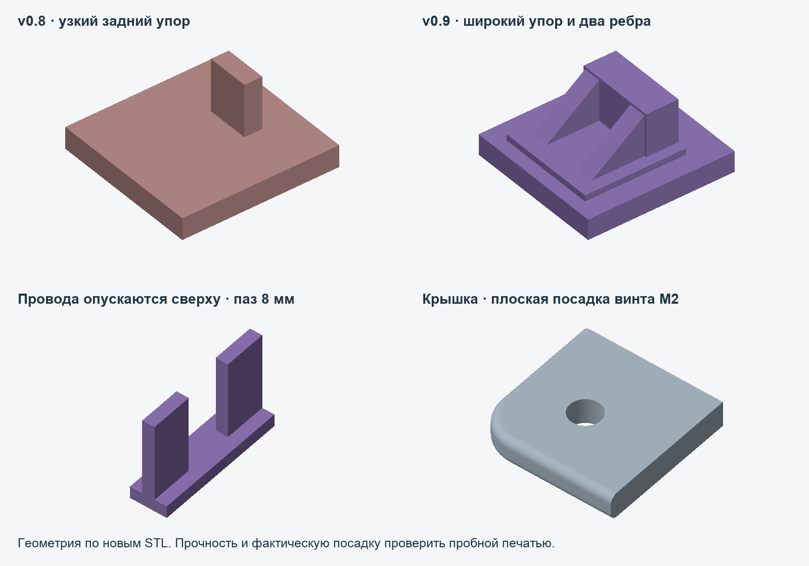

# Enclosure v0.9 — reinforced rear stop, drop-in wires, socket-head screws

[Русская версия](../../docs/ru/ENCLOSURE-v09.md) · [Previous v0.8](../v0.8/README.md)



## What changed

The controller's single rear axial stop fractured in use. Its fitted contact
plane remains 0.15 mm behind the PCB, but its wall is now **3.2 × 8 mm** instead
of 1.65 × 4 mm. A **10 × 10 mm floor-overlapping foot** and two **6 mm long,
1.8 mm thick triangular gussets** distribute load into the floor. Gussets end
before the divider's wire opening. This is geometric reinforcement, not a tested
strength rating or fatigue-life claim.

The divider now has an **8 mm wide slot open from the top down to the floor**.
Solder the two boards and wires outside the case, seat the boards, then lower
the wires into the slot. Threading wires through a closed bottom opening is
no longer necessary. Keep the wires clear of PCB supports and the lid.

The lid has **straight Ø2.4 mm holes with flat external head seats** for M2
socket-head screws. There are no countersinks or recessed head pockets. Heads
remain above the lid; their height is additional to the case's 17 mm shell
height. M2 × 10 mm is now measured **under the head**, unlike the old countersunk
screw's overall length. With that length, nominal tip-to-hole-bottom clearance
is 2 mm. Pilot holes remain Ø1.7 mm for threading into plastic; verify actual
thread fit with the screw coupon, and do not force a binding screw.

## What to print

- **`base.stl` + `lid.stl`**: replacement full enclosure, assembled shell
  78 × 40 × 17 mm. Use both v0.9 files for the requested configuration.
- **`fit_esp32_snaps.stl`**: recommended first test, 37.8 × 24.6 × 15 mm;
  includes the actual reinforced rear stop, side tabs and flush USB wall.
- `fit_esp32.stl`: the same controller sample without side tabs.
- `screw_test_base.stl` + `screw_test_cap.stl`: test M2 screw engagement and
  flat head seating before assembling the case.
- `fit_sensor.stl` + `fit_sensor_snaps.stl`: byte-identical to v0.8; no need
  to print them again if already fitted.

Print at 100% scale in millimeters. Base and fit samples are bottom-down.
The lid STL is already inverted, with its flat outside face on the bed.
Start with a 0.4 mm nozzle, 0.2 mm layers, four perimeters and six bottom layers.
Do not fill flexible tab slots with supports. These are starting print settings;
actual layer adhesion, material, screw fit and durability need a physical check.

Board dimensions, support locations, USB flush position, capsule opening and
OLED window are unchanged. The full case still uses supports plus lid retention
features; side snap tabs exist only on fit samples. Head height and wire bend
behavior are not included in the digital component models.

## Rebuild and validate

Use Python 3.12+ and `requirements-cad.txt`, from the repository root:

```sh
.tooling/venv/bin/python enclosure/v0.9/build_enclosure.py
.tooling/venv/bin/python enclosure/v0.9/build_samples.py
.tooling/venv/bin/python enclosure/v0.9/build_fastener_test.py
.tooling/venv/bin/python enclosure/v0.9/check_mount.py
.tooling/venv/bin/python enclosure/v0.9/check_usb_profile.py
.tooling/venv/bin/python enclosure/v0.9/check_revision.py
.tooling/venv/bin/python enclosure/v0.9/preview_controller.py
.tooling/venv/bin/python enclosure/v0.9/preview_changes.py
```

All eight serialized STL files are closed, consistently wound single solids.
Checks cover board/component envelopes, vertical board insertion, lid removal,
flush USB and its capsule profile, unchanged sensor samples, the stop contact
plane, flat head seats and a clear geometric wire-drop envelope. Comparing the
bases confirms that the only removed base material is in the opened wire slot.
`validation_revision.json` records the revision-specific checks. The root section
increased from 6.6 to 100 mm² at the tested floor slice; that ratio is **not** a
load-capacity multiplier. No FEA, destructive testing or fatigue testing was done.

STLs are generated directly with manifold3d. SCAD sources are included but have
not been independently compiled in OpenSCAD. v0.8 remains unchanged as a reference.
